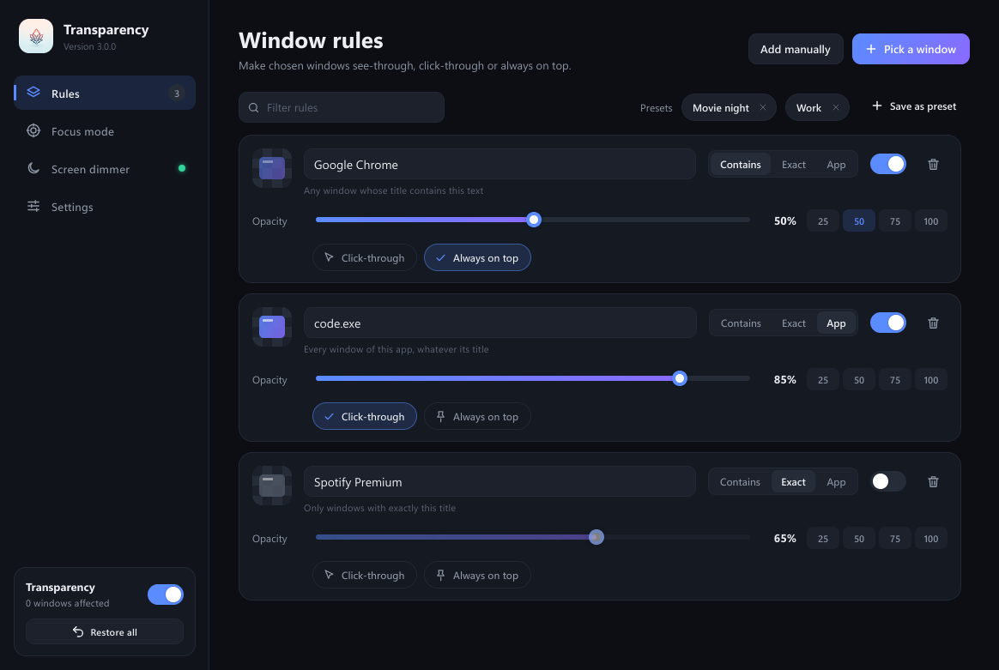

<h1 align="center">Transparency App</h1>

<p align="center">
  Make any window on Windows see-through, per app, with a slider. Dim each screen below its lowest brightness.
</p>

<p align="center">
  <a href="https://github.com/AkshitIreddy/TransparencyApp/releases/latest"></a>
  
  
</p>

<p align="center">
  
</p>

## What it is

Transparency App is a small, native tray utility for Windows. Set the opacity
of other apps' windows, fade everything except the window you are using, or
dim a screen further than its brightness setting allows. Rules keep working
for windows you open later, and the app sits quietly in the system tray.

Version 3 is a rewrite in Rust: one 11 MB executable with no runtime to
unpack, a fresh interface, and much lower memory use.

## Highlights

- **Per-app transparency rules.** Match by title text, exact title or app,
  each with its own opacity, plus optional click-through and always on top.
- **Pick a window.** Choose one of your open windows instead of guessing its
  exact title.
- **Presets.** Save rule sets and switch between them in one click.
- **Focus mode.** Everything except the window you are using fades back, and
  the focus follows you.
- **Per-screen dimmer.** Hardware gamma dimming (taskbar and fullscreen apps
  included, screenshots unaffected) with an overlay for extra depth. Each
  screen has its own level, and screens you connect later are left alone until
  you switch them on.
- **Safe with laptop lids, sleep and replugging.** The original brightness of
  every screen is kept on disk, so a screen that was off while dimming changed
  is put right as soon as it comes back.
- **Global shortcuts**, all remappable. **Start with Windows**, **import and
  export**, **dark, light or system theme**, **seven accent colours**.
- **Verified updates** from GitHub Releases (SHA-256 checked, rollback copy
  kept).

## Install

1. Download **`TransparencyApp.exe`** from the
   [latest release](https://github.com/AkshitIreddy/TransparencyApp/releases/latest).
2. Run it. No installer and no admin rights needed.
3. Optional: turn on **Settings, Start with Windows**.

Settings from earlier versions (`%APPDATA%\TransparencyApp\config.json`) are
picked up automatically.

> Windows SmartScreen may warn about a new unsigned app. Choose
> **More info, Run anyway**. The executable is built in the open by
> [GitHub Actions](.github/workflows/release.yml).

## Shortcuts

| Shortcut | Action |
| --- | --- |
| `Ctrl+Alt+T` | Toggle transparency rules |
| `Ctrl+Alt+F` | Toggle focus mode |
| `Ctrl+Alt+D` | Toggle the screen dimmer |
| `Ctrl+Alt+↑` / `↓` | Active window more or less opaque |
| `Ctrl+Alt+Home` | Restore every window (panic) |

The full guide is in **[docs/USAGE.md](docs/USAGE.md)**.

## How it works

Window opacity uses Windows *layered windows*. The app listens for window
events (`SetWinEventHook`) and applies rules only when something changes, so
it costs nothing while idle. One worker thread owns every window change, each
window's original state is recorded so it can be restored exactly, and a crash
ledger lets the next launch clean up after a crash.

The dimmer scales each screen's hardware gamma ramp. Screens are identified by
their monitor device path rather than `\\.\DISPLAYn` names (which move around
when the display layout changes), the true original ramp is stored before any
change, and a restore owed to a screen that is currently off is retried when
it returns, even in a later session.

## Build from source

Needs Rust (stable, MSVC toolchain) on Windows:

```powershell
cargo build --release
target\release\TransparencyApp.exe
```

See **[docs/BUILDING.md](docs/BUILDING.md)** for tests and releases. Changes
are tracked in **[CHANGELOG.md](CHANGELOG.md)**.

## License

Released under the [MIT License](LICENSE). The interface is built with
[Slint](https://slint.dev) under its royalty-free license.
